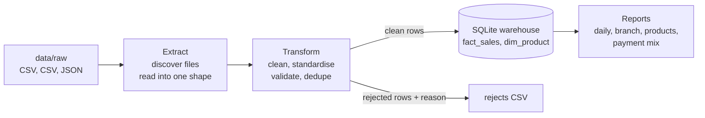

# Sales Data Pipeline (Python ETL)


A small but complete **extract, transform and load** pipeline. Three branches of a retailer export their monthly sales in three different formats. The pipeline:

1. **Extracts** every new export file from `data/raw`.
2. **Transforms** the rows: standardises SKUs, dates, prices and payment methods, fixes what can be fixed safely, and rejects what can't, with a reason for each rejected row.
3. **Loads** the clean rows into a SQLite warehouse, safely re-runnable without duplicates.
4. **Reports** daily sales, revenue by branch, top products and payment mix.

It uses only the Python standard library, so there's nothing to install.

**Tech:** Python 3.10+ · `csv`, `json`, `sqlite3`, `decimal`, `logging`, `argparse`, `unittest` · GitHub Actions

---

## The problem it solves

Each branch's system exports the same information differently:

| Branch | Format | Example row |
|---|---|---|
| Sandton store | Comma CSV, ISO dates | `SDN-10002,2026-09-12 17:03,EL-1002,2,199.00,card` |
| Durban store | **Semicolon** CSV, **day-first** dates, `R1 199,00` amounts, SKUs without a dash | `DBN5002;14/09/2026 18:03;BP3004;3;R1 199,00;Debit card` |
| Online store | **Nested JSON**: one order with several lines | `{"order_ref": "WEB-30001", "lines": [{"sku": …, "qty": 1, "price": 229.0}], …}` |

The exports also contain the kind of errors real exports do: impossible dates (31 September, month 13), unknown products, a quantity of `0`, `-1` or `"two"`, missing SKUs, a price keyed as R12 990 instead of R169, missing prices and duplicate rows.

## How it works



| Step | Module | What it does |
|---|---|---|
| Configure | `pipeline/config.py` | Describes each branch's file pattern, delimiter, date formats and column names. **Adding a branch means adding config, not code.** |
| Extract | `pipeline/extract.py` | Finds matching files, reads CSV and nested JSON into one common record, and fingerprints each file (SHA-256). |
| Transform | `pipeline/transform.py` | Parses and validates every field. Money uses `Decimal`, never floats. |
| Load | `pipeline/load.py` | Writes to SQLite inside one transaction per file, plus CSVs of clean and rejected rows. |
| Report | `pipeline/report.py` | SQL reports to CSV, and a markdown summary of each run. |

### Cleaning rules

| Problem | What happens |
|---|---|
| `el-1001`, `EL1001`, ` EL-1001 ` | Fixed to `EL-1001` |
| `R1 199,00`, `1,234.50`, `1.234,50` | Parsed to `1199.00`, `1234.50`, `1234.50` |
| `14/09/2026 18:03`, `2026-09-08T10:21:00+02:00` | Parsed with the formats configured for that branch |
| Missing price | Filled from the product catalogue, marked `price_source = catalogue` |
| `Credit Card`, `SNAPSCAN`, `voucher` | Mapped to `card`, `mobile`, `other` |
| Impossible or future date | **Rejected** |
| Unknown or missing SKU | **Rejected** |
| Quantity `0`, `-1`, `two`, or missing | **Rejected** |
| Price more than 50% away from the list price | **Rejected** as a likely keying error |
| Same transaction twice in a file | Second copy **rejected** as a duplicate |

### Safe to re-run (idempotent)

- Each file's SHA-256 is stored in `ingested_files`. A file that was already loaded is **skipped**. If its contents change, it's processed again.
- Sales have a primary key of `(branch, transaction_id)`, so even with `--force` a sale is **never inserted twice**.
- Each file loads inside one transaction, so a crash can't leave half a file in the warehouse.
- Every run is recorded in `pipeline_runs` with its counts and status.

## Running it

```bash
python run_pipeline.py              # process new files in data/raw
python run_pipeline.py --dry-run    # clean and report, but load nothing
python run_pipeline.py --force      # reprocess files already loaded
python run_pipeline.py -v           # also log every rejected row

python -m unittest discover -s tests -t . -v    # run the tests
python scripts/make_sample_data.py              # recreate the sample exports
```

Outputs go to `output/`:

```
output/
  warehouse.db                     SQLite: fact_sales, dim_product, ingested_files, pipeline_runs
  clean/clean_<run>.csv            every row that was loaded
  rejects/rejects_<run>.csv        every rejected row, with the reason and the original values
  reports/daily_sales.csv          transactions, units and revenue per day and branch
  reports/branch_summary.csv       revenue and share per branch
  reports/run_summary_<run>.md     what happened in the run
  logs/pipeline.log
```

## Example run

```
INFO    Run 20261021-224419-5302: 3 file(s) found in data\raw
INFO    sandton_sales_2026-09.csv        read  182  clean  176  loaded  176  rejected   6
INFO    durban_sales_2026-09.csv         read  141  clean  136  loaded  136  rejected   5
INFO    online_orders_2026-09.json       read  131  clean  127  loaded  127  rejected   4
INFO    Done: 439 loaded, 15 rejected, 0 skipped file(s)
```

Running it again straight away:

```
INFO    Skipping sandton_sales_2026-09.csv: already loaded (same contents)
INFO    Skipping durban_sales_2026-09.csv: already loaded (same contents)
INFO    Skipping online_orders_2026-09.json: already loaded (same contents)
INFO    Done: 0 loaded, 0 rejected, 3 skipped file(s)
```

From the run summary:

| reason | rows |
|---|---|
| duplicate transaction id in this file | 3 |
| quantity must be at least 1 | 2 |
| invalid sale date: 'not a date' | 2 |
| invalid sale date: '2026-09-31 10:15' | 1 |
| invalid sale date: '15/13/2026 09:00' | 1 |
| price 12990.00 is more than 50% away from list price 169.00 | 1 |
| unknown SKU: EL-9999 | 1 |
| *…and 4 more* | |

| branch | sale_lines | units | revenue | avg_daily_revenue | share_pct |
|---|---|---|---|---|---|
| SANDTON | 176 | 244 | 85676.0 | 2855.87 | 42.0 |
| DURBAN | 136 | 198 | 71812.0 | 2476.28 | 35.2 |
| ONLINE | 127 | 154 | 46576.0 | 1606.07 | 22.8 |

## Tests

19 tests with `unittest`, run on every push by GitHub Actions:

- **Unit tests** for every parser: money in five formats, dates, quantities, SKUs, payment methods, and each reject rule.
- **End-to-end tests** that run the whole pipeline in a temporary folder and check that a re-run skips loaded files, `--force` never duplicates a sale, `--dry-run` writes nothing, and a changed file is picked up again.

## What I would add next

- Load to PostgreSQL instead of SQLite (only `load.py` would change).
- Schedule it daily (cron or Airflow) and send the run summary by email.
- Quarantine whole files that fail more than a set share of rows.
